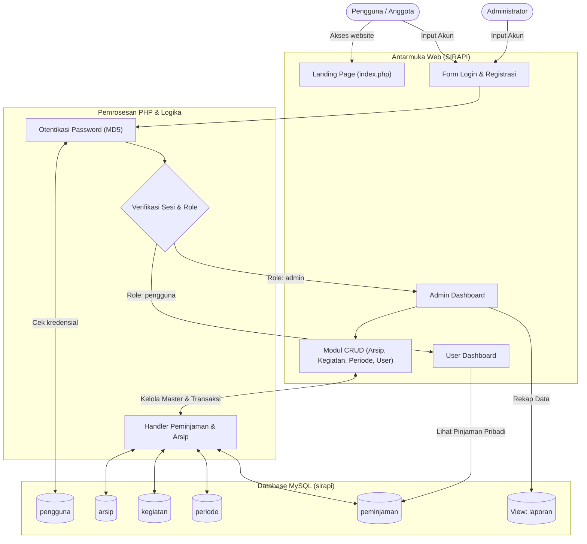
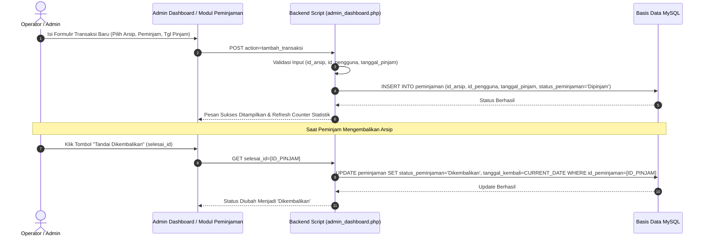
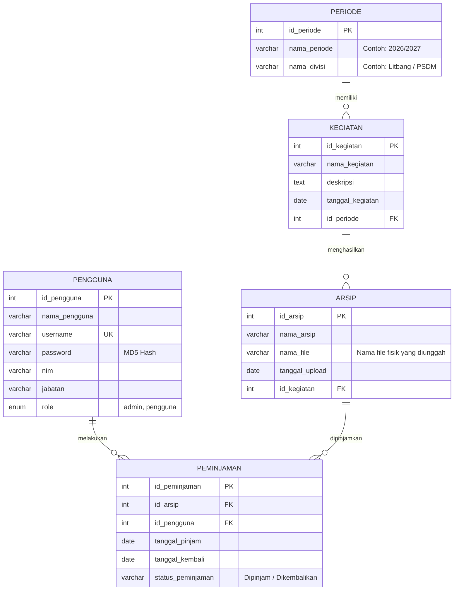

# 📂 SIRAPI - Sistem Informasi Kearsipan Terpadu

> **Sistem Informasi Manajemen Arsip, Pengarsipan Dokumen Kegiatan, dan Sirkulasi Peminjaman Berbasis Web.**  
> Dirancang untuk organisasi, UKM (Unit Kegiatan Mahasiswa), instansi, atau divisi kepengurusan agar pengelolaan dokumen fisik dan digital terorganisir rapi, transparan, dan terdata akurat.

---

## 📑 Daftar Isi
1. [Ringkasan & Fitur Utama](#-ringkasan--fitur-utama)
2. [Arsitektur Sistem & Struktur Direktori](#-arsitektur-sistem--struktur-direktori)
3. [Aliran Data Sistem (Data Flow & Sequence)](#-aliran-data-sistem-data-flow--sequence)
4. [Skema & Relasi Database (ERD)](#-skema--relasi-database-erd)
5. [Tutorial Instalasi & Cara Menjalankan (Tutorial Run)](#-tutorial-instalasi--cara-menjalankan-tutorial-run)
6. [Panduan Operasional (Untuk Operator & User)](#-panduan-operasional-untuk-operator--user)
7. [Panduan Pemeliharaan & Troubleshooting (Untuk Teknisi / IT Support)](#-panduan-pemeliharaan--troubleshooting-untuk-teknisi--it-support)
8. [Panduan Service Code & Tuning Keamanan (Untuk Software Engineer)](#-panduan-service-code--tuning-keamanan-untuk-software-engineer)
9. [Protokol Pengembangan & Pembaruan Sistem](#-protokol-pengembangan--pembaruan-sistem)

---

## 🚀 Ringkasan & Fitur Utama

SIRAPI memodernisasi proses administrasi arsip konvensional menjadi terpusat dengan antarmuka web modern bernuansa *Clean Green UI*. 

### ✨ Fitur Unggulan
- **Single-Door Role-Based Authentication**: Halaman login otomatis mendeteksi role (`admin` atau `pengguna`) dan mengarahkan pengguna langsung ke dashboard yang sesuai tanpa perlu memilih portal secara manual.
- **Proteksi Akses URL Terpusat (Route Guard)**: Mencegah akses langsung jika tautan (seperti `laporan/index.php` atau modul CRUD) disalin ke browser/device lain tanpa login aktif. Sistem otomatis mengarahkan ke halaman login dengan pesan peringatan dan mengembalikan pengguna ke halaman tujuan setelah berhasil login.
- **Registrasi Akun Anggota Mandiri**: Calon anggota/staff dapat mendaftar sendiri melalui form registrasi terproteksi dengan password hashing terenkripsi.
- **Hierarki Data Kearsipan Terstruktur**: Mengelompokkan arsip berdasarkan **Periode Kepengurusan** $\rightarrow$ **Kegiatan / Program Kerja** $\rightarrow$ **Berkas Arsip Fisik / Digital**.
- **Pencatatan Transaksi Peminjaman Arsip**: Peminjaman arsip tercatat dengan tanggal pinjam, estimasi kembali, serta aksi satu klik untuk penyelesaian pengembalian arsip.
- **Dashboard Statistik Interaktif**:
  - **Admin**: Menampilkan metrik total arsip, total anggota, arsip sedang dipinjam, arsip selesai dikembalikan, transaksi terbaru, serta shortcut input cepat peminjaman.
  - **Pengguna**: Menampilkan ringkasan pinjaman aktif pribadi dan riwayat peminjaman arsip sebelumnya.
- **Laporan Kearsipan Terpadu**: Monitoring rekapitulasi seluruh transaksi arsip dalam satu tabel ringkas.

---

## 🏛 Arsitektur Sistem & Struktur Direktori

SIRAPI dibangun menggunakan arsitektur **Clean Modular PHP** dengan pemisahan direktori yang sangat rapi dan terisolasi:

```
c:\xampp\htdocs\SIRAPI\
│
├── index.php                 # Landing page publik utama (Hero, fitur, shortcut login/dashboard)
├── GEMINI.md                 # Protokol pengerjaan otomatis bagi AI Assistant
├── PROGRESION.md             # Logbook riwayat perubahan per task/prompt (Changelog)
├── README.md                 # Dokumentasi komprehensif sistem (Dokumen ini)
│
├── assets/                   # Aset Tampilan & Gaya
│   └── css/
│       └── style.css         # Master Stylesheet tema Modern Nature Emerald
│
├── auth/                     # Modul Otentikasi & Keanggotaan
│   ├── login.php             # Gerbang login satu pintu cerdas (Auto-deteksi Admin & Pengguna)
│   ├── register.php          # Pendaftaran mandiri anggota/pengguna baru
│   └── logout.php            # Pembersihan sesi (session_destroy) dan redirect ke login
│
├── dashboard/                # Modul Pusat Antarmuka Kerja Utama
│   ├── admin_dashboard.php   # Dashboard Administrator (Statistik, Management Hub, Monitoring & Peminjaman)
│   ├── user_dashboard.php    # Dashboard Pengguna (Statistik Ringkas & Direktori Kartu Divisi)
│   └── divisi_detail.php     # Halaman Khusus Eksplorasi Kegiatan & Dokumen per Divisi
│
├── includes/                 # Logika & Helper Terpusat Backend
│   ├── koneksi.php           # Konfigurasi koneksi basis data MySQLi terpusat
│   ├── auth_check.php        # Middleware proteksi akses sesi, guard role, & redirect target
│   └── denda_helper.php      # Helper modul denda bertingkat & modal QRIS / E-Wallet interaktif
│
├── arsip/                    # Modul Pengelolaan Data Arsip
│   ├── index.php             # Tabel daftar arsip
│   ├── tambah.php            # Form upload & tambah data arsip
│   ├── edit.php              # Form edit informasi arsip
│   └── hapus.php             # Handler hapus data arsip
│
├── kegiatan/                 # Modul Pengelolaan Kegiatan / Program Kerja
│   ├── index.php             # Tabel kegiatan
│   ├── tambah.php            # Form tambah kegiatan terkait periode
│   ├── edit.php              # Form edit kegiatan
│   └── hapus.php             # Handler hapus kegiatan
│
├── peminjaman/               # Modul Transaksi Peminjaman, Pengembalian & Rekap Denda
│   ├── index.php             # Monitoring sirkulasi, riwayat denda, & tombol bayar QRIS
│   ├── tambah.php            # Input form peminjaman arsip
│   ├── edit.php              # Perubahan status & tanggal pengembalian
│   └── hapus.php             # Handler hapus riwayat peminjaman
│
├── pengguna/                 # Modul Manajemen Akun & Hak Akses (Khusus Admin)
│   ├── index.php             # Tabel seluruh akun pengguna
│   ├── tambah.php            # Pembuatan akun admin/pengguna baru
│   ├── edit.php              # Edit profil, jabatan, role, dan reset password
│   └── hapus.php             # Handler hapus akun pengguna
│
├── periode/                  # Modul Master Periode Kepengurusan & Divisi
│   ├── index.php             # Tabel periode kepengurusan & divisi
│   ├── tambah.php            # Form tambah periode & divisi
│   ├── edit.php              # Form edit periode
│   └── hapus.php             # Handler hapus periode
│
└── uploads/                  # Direktori Penyimpanan Berkas Fisik & Gambar
    ├── arsip/                # File dokumen atau berkas fisik arsip yang diunggah
    └── hero-illustration.jpg # Aset visual landing page
```

---

## 🔄 Aliran Data Sistem (Data Flow & Sequence)

### 1. Diagram Aliran Data (Data Flow Diagram - Level 1)



### 2. Alur Transaksi Peminjaman dan Pengembalian Arsip



---

## 🗄 Skema & Relasi Database (ERD)

Database MySQL yang digunakan adalah `sirapi`. Relasi data terpusat pada integritas referensial dari struktur kepengurusan hingga sirkulasi arsip:



---

## 💻 Tutorial Instalasi & Cara Menjalankan (Tutorial Run)

Panduan ini ditujukan bagi **Teknisi** atau **Developer** yang ingin menyalakan dan menjalankan SIRAPI dari awal di lingkungan lokal komputer.

### Prasyarat Perangkat Lunak
- **Web Server & DBMS**: [XAMPP](https://www.apachefriends.org/) (Direkomendasikan dengan PHP 8.0 ke atas dan MySQL / MariaDB).
- **Web Browser**: Google Chrome, Mozilla Firefox, Microsoft Edge, atau Safari modern.

### Langkah 1: Penempatan Berkas Proyek
1. Pastikan folder proyek berada di direktori publik server web:
   ```
   C:\xampp\htdocs\SIRAPI
   ```

### Langkah 2: Menyalakan Layanan Web & Database
1. Buka **XAMPP Control Panel**.
2. Klik tombol **Start** pada modul **Apache**.
3. Klik tombol **Start** pada modul **MySQL**.
4. Pastikan kedua modul berubah status menjadi hijau (*Running*).

### Langkah 3: Menyiapkan Database MySQL
1. Buka browser dan buka phpMyAdmin di alamat:
   ```
   http://localhost/phpmyadmin/
   ```
2. Buat database baru bernama `sirapi` dengan *collation* `utf8mb4_general_ci`.
3. Jalankan query SQL berikut di tab **SQL** untuk membuat seluruh tabel dan view:

```sql
CREATE DATABASE IF NOT EXISTS `sirapi` CHARACTER SET utf8mb4 COLLATE utf8mb4_general_ci;
USE `sirapi`;

-- 1. Tabel Periode
CREATE TABLE IF NOT EXISTS `periode` (
  `id_periode` INT AUTO_INCREMENT PRIMARY KEY,
  `nama_periode` VARCHAR(100) NOT NULL,
  `nama_divisi` VARCHAR(100) NOT NULL
) ENGINE=InnoDB DEFAULT CHARSET=utf8mb4;

-- 2. Tabel Kegiatan
CREATE TABLE IF NOT EXISTS `kegiatan` (
  `id_kegiatan` INT AUTO_INCREMENT PRIMARY KEY,
  `nama_kegiatan` VARCHAR(255) NOT NULL,
  `deskripsi` TEXT NULL,
  `tanggal_kegiatan` DATE NULL,
  `id_periode` INT NULL,
  CONSTRAINT `fk_kegiatan_periode` FOREIGN KEY (`id_periode`) 
    REFERENCES `periode` (`id_periode`) ON DELETE SET NULL ON UPDATE CASCADE
) ENGINE=InnoDB DEFAULT CHARSET=utf8mb4;

-- 3. Tabel Arsip
CREATE TABLE IF NOT EXISTS `arsip` (
  `id_arsip` INT AUTO_INCREMENT PRIMARY KEY,
  `nama_arsip` VARCHAR(255) NOT NULL,
  `nama_file` VARCHAR(255) NULL,
  `tanggal_upload` DATE NULL,
  `id_kegiatan` INT NULL,
  CONSTRAINT `fk_arsip_kegiatan` FOREIGN KEY (`id_kegiatan`) 
    REFERENCES `kegiatan` (`id_kegiatan`) ON DELETE SET NULL ON UPDATE CASCADE
) ENGINE=InnoDB DEFAULT CHARSET=utf8mb4;

-- 4. Tabel Pengguna
CREATE TABLE IF NOT EXISTS `pengguna` (
  `id_pengguna` INT AUTO_INCREMENT PRIMARY KEY,
  `nama_pengguna` VARCHAR(150) NOT NULL,
  `username` VARCHAR(50) NOT NULL UNIQUE,
  `password` VARCHAR(255) NOT NULL,
  `nim` VARCHAR(30) NULL,
  `jabatan` VARCHAR(100) NULL,
  `role` ENUM('admin', 'pengguna') NOT NULL DEFAULT 'pengguna'
) ENGINE=InnoDB DEFAULT CHARSET=utf8mb4;

-- 5. Tabel Peminjaman (Dilengkapi Sistem Denda Keterlambatan)
CREATE TABLE IF NOT EXISTS `peminjaman` (
  `id_peminjaman` INT AUTO_INCREMENT PRIMARY KEY,
  `id_arsip` INT NOT NULL,
  `id_pengguna` INT NOT NULL,
  `tanggal_pinjam` DATE NOT NULL,
  `tanggal_kembali` DATE NULL,
  `status_peminjaman` VARCHAR(50) NOT NULL DEFAULT 'Dipinjam',
  `denda` INT NOT NULL DEFAULT 0,
  `status_denda` VARCHAR(30) NOT NULL DEFAULT 'Bebas Denda',
  `tanggal_dikembalikan` DATE NULL,
  `metode_pembayaran` VARCHAR(50) NULL,
  `tanggal_bayar_denda` DATETIME NULL,
  CONSTRAINT `fk_peminjaman_arsip` FOREIGN KEY (`id_arsip`) 
    REFERENCES `arsip` (`id_arsip`) ON DELETE CASCADE ON UPDATE CASCADE,
  CONSTRAINT `fk_peminjaman_pengguna` FOREIGN KEY (`id_pengguna`) 
    REFERENCES `pengguna` (`id_pengguna`) ON DELETE CASCADE ON UPDATE CASCADE
) ENGINE=InnoDB DEFAULT CHARSET=utf8mb4;

-- 6. View Laporan Peminjaman & Denda
CREATE OR REPLACE VIEW `laporan` AS
SELECT 
    p.id_peminjaman,
    u.nama_pengguna,
    a.nama_arsip,
    p.tanggal_pinjam,
    p.tanggal_kembali,
    p.status_peminjaman,
    p.denda,
    p.status_denda,
    p.tanggal_dikembalikan,
    p.metode_pembayaran
FROM `peminjaman` p
LEFT JOIN `pengguna` u ON p.id_pengguna = u.id_pengguna
LEFT JOIN `arsip` a ON p.id_arsip = a.id_arsip;

-- 7. Akun Awal (Default Seeding)
-- Password default: admin123 (MD5: 0192023a7bbd73250516f069df18b500)
INSERT INTO `pengguna` (`nama_pengguna`, `username`, `password`, `nim`, `jabatan`, `role`) VALUES
('Administrator SIRAPI', 'admin', '0192023a7bbd73250516f069df18b500', '10000001', 'Kepala Arsip', 'admin'),
('Staff Anggota', 'user', '0192023a7bbd73250516f069df18b500', '10000002', 'Staff Divisi', 'pengguna')
ON DUPLICATE KEY UPDATE `id_pengguna`=`id_pengguna`;
```

### Langkah 4: Memeriksa Koneksi Database
Pastikan isi berkas `koneksi.php` sesuai dengan konfigurasi lokal XAMPP Anda:
```php
<?php
$host = "localhost";
$user = "root";
$password = "";
$database = "sirapi";

$conn = mysqli_connect($host, $user, $password, $database);
if (!$conn) {
    die("Koneksi database gagal: " . mysqli_connect_error());
}
mysqli_set_charset($conn, "utf8mb4");
?>
```

### Langkah 5: Menjalankan dan Membuka Aplikasi
1. Buka browser dan ketik alamat:
   ```
   http://localhost/SIRAPI/
   ```
2. Anda akan melihat halaman Beranda (*Landing Page*).
3. Klik tombol **Login Sistem** atau buka `http://localhost/SIRAPI/login.php`.
4. Masuk dengan akun uji coba:
   - **Admin**: Username: `admin` | Password: `admin123`
   - **User**: Username: `user` | Password: `admin123`

---

## 👤 Panduan Operasional (Untuk Operator & User)

### 1. Masuk & Keluar Sistem
- **Login Satu Pintu (`login.php`)**: Cukup masukkan username dan password. Sistem secara cerdas mendeteksi apakah Anda Administrator atau Anggota biasa.
- **Logout (`logout.php`)**: Selalu klik tombol **Keluar / Logout** pada pojok kanan atas sidebar setelah selesai bertugas demi keamanan data.
- **Navigasi Dinamis Antar-Halaman**: Pada setiap tabel data (Pengguna, Arsip, Kegiatan, Peminjaman, Periode, dan Laporan), tombol navigasi di atas tabel otomatis menyesuaikan peran aktif Anda: menampilkan *“← Kembali ke Dashboard Admin”* atau *“← Kembali ke Dashboard Pengguna”* agar alur kerja tidak terputus kembali ke beranda publik.

### 2. Panduan untuk Operator / Administrator
1. **Pusat Pengelolaan Data Master (Management Hub & Ringkasan Eksekutif)**:
   - Dashboard Admin difokuskan sebagai *Executive Overview Workspace* yang rapi dan elegan: menyajikan 6 kartu statistik kunci (**Total Arsip**, **Pengguna Terdaftar**, **Periode & Divisi**, **Total Kegiatan**, **Sedang Dipinjam**, dan **Denda Tertunggak**), serta grid menu pengelolaan data master (**Katalog Arsip**, **Periode & Divisi**, **Kegiatan Organisasi**, **Akun Pengguna**, dan **Sirkulasi Pinjaman**).
2. **Akses Halaman Dedicated Sirkulasi & Monitoring Denda (via Sidebar)**:
   - Demi menjaga Dashboard utama tetap ringkas, bersih, dan cepat dimuat, tabel sirkulasi dan formulir pencatatan peminjaman dipusatkan pada halaman khusus yang diakses melalui menu sidebar: **Sirkulasi & Monitoring Denda** (mengarah ke `peminjaman/index.php`).
   - Halaman ini menyajikan antarmuka 2 kolom modern:
     - **Sisi Kiri**: Tabel monitoring sirkulasi real-time dengan filter pills instan (*Semua*, *Dipinjam*, *Telat/Denda*, *Dikembalikan*) dan kolom pencarian cepat (*instant live search*).
     - Tombol cepat **✓ Selesai** mencatat pengembalian per hari ini secara otomatis tanpa menimpa batas tanggal kembali asli.
     - Tombol **💳 QRIS** membuka popup pembayaran digital, dan tombol **✓ Lunas** untuk verifikasi denda secara instan.
     - **Sisi Kanan**: Formulir **Catat Peminjaman Cepat** (pilih dokumen arsip, anggota UKM peminjam, tanggal pinjam, dan batas tanggal kembali otomatis dihitung **5 hari** ke depan).
3. **Verifikasi Pembayaran Denda**:
   - Admin dapat memantau kartu statistik **Denda Tertunggak** di dashboard admin.
   - Transaksi dengan denda yang sudah disetor dapat diverifikasi oleh admin secara langsung di halaman Sirkulasi dengan mengklik tombol **✓ Lunas** atau melalui modal pembayaran QRIS/E-Wallet.
5. **Mengunggah & Mendata Arsip Baru**:
   - Buka menu **Kelola Arsip** $\rightarrow$ **Tambah Arsip**.
   - Masukkan nama arsip, nama file (atau unggah berkas fisik ke folder arsip), tanggal upload, dan kegiatan yang menaungi arsip tersebut.
6. **Menata Struktur Kepengurusan**:
   - Buat terlebih dahulu **Periode** (contoh: *2026/2027 - Divisi Humas*).
   - Buat **Kegiatan** yang terhubung ke periode tersebut.
   - Arsip yang ditambahkan kemudian dapat dikaitkan dengan kegiatan terkait.

### 3. Panduan untuk Pengguna / Anggota (Penelusur Arsip)
1. **Ringkasan Peminjaman & Denda di Bagian Teratas Dashboard**:
   - Di bagian paling atas Dashboard Pengguna (`user_dashboard.php`), terdapat 3 kartu statistik personal: **Sedang Dipinjam**, **Sudah Dikembalikan**, dan **Tagihan Denda Keterlambatan**.
   - Kartu ini memberikan informasi sekilas yang langsung terlihat saat pertama kali masuk, dan dapat diklik untuk membuka halaman riwayat transaksi lengkap.
2. **Detail Peminjaman & Denda Terisolasi di Sidebar**:
   - Demi menjaga antarmuka penelusuran arsip tetap rapi, bersih, dan fokus, tabel detail peminjaman tidak dimuat di dashboard utama.
   - Pengguna dapat mengakses riwayat transaksi lengkap, tanggal batas pengembalian, status keterlambatan, serta opsi pembayaran QRIS/E-Wallet kapan saja melalui menu **Detail Peminjaman & Denda** pada sidebar navigasi (mengarah ke `peminjaman/index.php`).
3. **Hierarki Penelusuran Halaman Khusus Divisi (Page-Level Drilldown)**:
   - Pengguna disajikan antarmuka eksplorasi arsip resmi yang rapi dan terisolasi:
     $$\text{Dashboard (Kartu Divisi)} \xrightarrow{\text{Klik Divisi}} \text{Halaman Khusus (divisi\_detail.php)} \xrightarrow{\text{Klik Kegiatan}} \text{Dokumen Arsip} \longrightarrow \text{Lihat / Unduh Dokumen}$$
   - **Tampilan Dashboard Pengguna (`user_dashboard.php`)**: Menampilkan 3 kartu status peminjaman di paling atas, filter periode, kartu-kartu divisi (nama divisi, periode, jumlah kegiatan, jumlah arsip), serta kolom pencarian langsung.
   - **Masuk ke Halaman Khusus Divisi (`divisi_detail.php`)**: Mengklik kartu divisi akan mengarahkan pengguna ke halaman tersendiri yang menampilkan banner identitas divisi, breadcrumb navigasi kembali, dan daftar kegiatan divisi terkait.
   - **Buka Dokumen per Kegiatan**: Pada halaman detail divisi, pengguna mengklik kegiatan tertentu untuk membuka daftar berkas arsip yang dinaungi.
   - **Lihat / Unduh Dokumen**: Klik tombol **Lihat Dokumen** untuk membuka file di tab baru, atau klik tombol **Pinjam &rarr;** untuk mengajukan peminjaman fisik berkas tersebut.
4. **Pencarian Cepat Kearsipan (Instant Live Search)**:
   - Pada dashboard pengguna, terdapat kolom pencarian untuk menyaring divisi. Pada halaman detail divisi (`divisi_detail.php`), terdapat kolom pencarian khusus untuk menyaring kegiatan dan arsip di divisi tersebut secara instan.
5. **Kotak Peringatan Aturan Peminjaman di Sidebar**:
   - Tepat di atas tombol *Keluar (Logout)* pada sidebar pengguna, disematkan kartu peringatan (*sidebar warning box*) yang mengingatkan bahwa masa pinjam maksimal berkas adalah **5 hari**, dan pengembalian setelahnya otomatis dinyatakan terlambat serta dikenai denda harian. Hal ini menjaga transparansi dan kedisiplinan sirkulasi arsip UKM.

---

### 4. Aturan dan Skema Tarif Perhitungan Denda Keterlambatan
Sistem SIRAPI menerapkan aturan perhitungan denda proporsional terstruktur:
- **Batas Waktu Standar**: 5 hari kalender terhitung sejak `tanggal_pinjam`.
- **Tepat Waktu ($\le 0$ hari)**: **Rp 0** (Status: *Bebas Denda*).
- **Terlambat 1 hari**: **Rp 20.000**
- **Terlambat 2 hari**: **Rp 22.500**
- **Terlambat 3 hari**: **Rp 25.000**
- **Terlambat 4 hari**: **Rp 30.000**
- **Terlambat $\ge 5$ hari**: **Rp 30.000 + ((hari - 4) $\times$ Rp 5.000)** (bertambah Rp 5.000 untuk setiap hari berikutnya).

---

## 🛠 Panduan Pemeliharaan & Troubleshooting (Untuk Teknisi / IT Support)

Panduan ini membantu teknisi memelihara server dan menangani kendala teknis harian.

| Kendala / Error | Gejala Masalah | Solusi Penanganan |
|---|---|---|
| **Koneksi Database Gagal** | Pesan: `Koneksi database gagal: Access denied for user...` atau `Unknown database 'sirapi'` | 1. Pastikan modul MySQL di XAMPP aktif.<br>2. Periksa nama database pada `koneksi.php` apakah sudah `sirapi`.<br>3. Jika password root MySQL diubah di XAMPP, sesuaikan `$password` di `koneksi.php`. |
| **Port Apache Conflict** | Apache tidak bisa Start (Port 80/443 *busy*) | Ubah *Listen port* Apache di `httpd.conf` dari `80` menjadi `8080`, lalu akses via `http://localhost:8080/SIRAPI/`. |
| **Gagal Menghapus Data Induk (Foreign Key Constraint)** | Error `Cannot delete or update a parent row: a foreign key constraint fails` | Terjadi jika mencoba menghapus data periode atau kegiatan yang masih memiliki arsip/transaksi terkait. Hapus atau pindahkan relasi data anak terlebih dahulu, atau pastikan opsi relasi menggunakan `ON DELETE SET NULL`. |
| **Upload Berkas Gagal / Permission Denied** | File tidak tersimpan ke folder `uploads/arsip/` | Pastikan folder `uploads/arsip/` memiliki hak akses tulis (*write permission*). Di lingkungan Windows/XAMPP, nonaktifkan atribut *Read-Only* pada folder tersebut. |
| **Akun Pendaftar Baru Tidak Bisa Login** | Registrasi berhasil di `register.php`, namun saat login selalu error username/password salah | Periksa konsistensi hashing: `login.php` memverifikasi `md5($password)`. Pastikan script registrasi menyimpan password terenkripsi MD5 (lihat instruksi tuning di bawah). |

### Prosedur Rutin Backup Database
Teknisi wajib melakukan backup berkala seminggu sekali:
```bash
# Backup melalui Command Line / Shell
mysqldump -u root -p sirapi > C:\backup_sirapi\sirapi_backup_%date%.sql
```
Atau melalui phpMyAdmin $\rightarrow$ Pilih database `sirapi` $\rightarrow$ Klik tab **Export** $\rightarrow$ Format **SQL** $\rightarrow$ Klik **Export**.

---

## ⚙️ Panduan Service Code & Tuning Keamanan (Untuk Software Engineer)

Bagian ini memuat analisis arsitektural dan panduan teknis bagi Software Engineer yang ingin merawat, mengoptimasi, serta meng-upgrade sistem SIRAPI.

### 1. Rekomendasi Refaktor Hashing Password (`MD5` $\rightarrow$ `password_hash`)
*Saat ini sistem menggunakan fungsi bawaan `md5()` untuk hashing password.*  
**Rekomendasi Upgrade:**  
MD5 sudah tidak direkomendasikan untuk keamanan modern karena rentan terhadap *collision attack* dan *rainbow tables*. Disarankan bertransisi menggunakan algoritma bawaan PHP `password_hash()` (Bcrypt / Argon2ID):

```php
// Sebelum (Eksisting):
$password_db = md5($input_password);
if ($password_db === $user['password']) { ... }

// Setelah (Rekomendasi Modern):
// Saat pembuatan user:
$hashed_password = password_hash($input_password, PASSWORD_BCRYPT, ['cost' => 12]);

// Saat verifikasi login:
if (password_verify($input_password, $user['password'])) {
    // Berhasil login
}
```

### 2. Implementasi Middleware Proteksi Route (`auth_check.php`)
Sistem telah menerapkan middleware terpusat `auth_check.php` di seluruh endpoint internal.
- Memeriksa `$_SESSION['login'] === true`.
- Jika belum login, menyimpan target `REQUEST_URI` ke dalam `$_SESSION['redirect_url']` dan mengalihkan pengguna ke `login.php?pesan=belum_login`.
- Setelah login berhasil, pengguna secara otomatis diarahkan kembali ke link yang ingin dibukanya.
- Menyediakan guard `require_admin()` khusus untuk modul administratif sensitif (seperti `pengguna/`).

### 3. Sinkronisasi Password Hashing pada `register.php` (Telah Diterapkan)
`register.php` kini secara konsisten mengenkripsi input password menggunakan `md5()` sebelum disimpan ke database, sehingga pengguna baru yang mendaftar dapat langsung login melalui `login.php`.

### 4. Resilient Report Query pada `laporan/index.php`
Halaman laporan menggunakan query langsung `LEFT JOIN` yang menggabungkan tabel `peminjaman`, `pengguna`, dan `arsip` secara mandiri. Hal ini memastikan halaman laporan tetap dapat menampilkan data secara optimal meskipun objek SQL View `laporan` belum dibuat atau terhapus di phpMyAdmin.

### 5. Tuning Indeks Database untuk Skalabilitas Data Besar
Saat data peminjaman dan arsip mencapai puluhan ribu baris, tambahkan indeks gabungan (*composite index*) untuk mempercepat query filtering:
```sql
ALTER TABLE `peminjaman` ADD INDEX `idx_status_pengguna` (`id_pengguna`, `status_peminjaman`);
ALTER TABLE `peminjaman` ADD INDEX `idx_tanggal_pinjam` (`tanggal_pinjam` DESC);
ALTER TABLE `arsip` ADD INDEX `idx_kegiatan_arsip` (`id_kegiatan`, `nama_arsip`);
```

### 6. Proteksi File Upload di Direktori `uploads/`
Untuk mencegah eksekusi script berbahaya (misal seseorang mengunggah file `shell.php`), letakkan file `.htaccess` di dalam folder `uploads/`:
```apache
# uploads/.htaccess
<FilesMatch "\.(php|php5|phtml|phar)$">
    Order Deny,Allow
    Deny from all
</FilesMatch>
Options -Indexes
```

### 7. Standarisasi Prepared Statements & Penanganan XSS
Seluruh output yang ditampilkan ke browser wajib menggunakan `htmlspecialchars($var, ENT_QUOTES, 'UTF-8')` seperti yang sudah diimplementasikan di sebagian besar modul. Pastikan saat menambah fitur baru, selalu gunakan `mysqli_prepare` untuk mencegah SQL Injection.

---

## 📌 Protokol Pengembangan & Pembaruan Sistem

Bagi developer atau AI Assistant yang mengembangkan fitur baru:
1. **Baca Histori**: Selalu baca catatan terbaru di `PROGRESION.md`.
2. **Tulis Log Perubahan**: Setelah selesai mengubah kode, catat tanggal, jam, prompt, dan ringkasan *before-after* di `PROGRESION.md`.
3. **Perbarui Dokumentasi**: Jika terdapat tabel baru, perubahan arsitektur, atau fitur antarmuka baru, perbarui dokumen `README.md` ini agar informasi selalu sinkron dengan kondisi proyek nyata.

---

*Dokumen ini disusun untuk memudahkan kolaborasi antara Operator, Teknisi, dan Engineer dalam mengoperasikan, merawat, dan mengembangkan sistem SIRAPI.*

